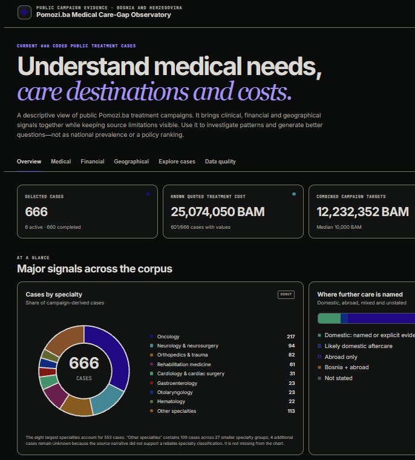
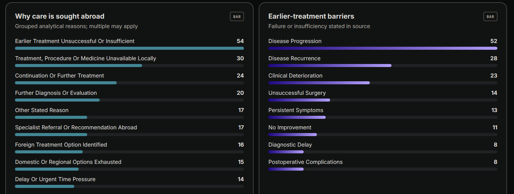

# Care Gap Observatory

**An interactive, evidence-conscious view of public medical-fundraising campaigns in Bosnia and Herzegovina.**

[Open the live app](https://bih-care-gap-observatory.pepicselver.chatgpt.site) · [View the anonymized data](data/)



Care Gap Observatory turns publicly available Pomozi.ba treatment campaigns into a structured, explorable corpus. It helps reveal which medical needs appear in public fundraising, where patients seek care, what costs are quoted, and where the source material does—or does not—support a conclusion.

## What you can explore

- **Medical profile** — specialties, diagnoses, age groups, urgency, and treatment types
- **Care pathways** — domestic, mixed, and abroad-only treatment journeys
- **Treatment destinations** — countries and facilities named in campaign narratives
- **Financial picture** — quoted treatment costs, campaign targets, and website-visible donations
- **Earlier-treatment barriers** — failed, insufficient, delayed, or unavailable care as stated in the source
- **Case explorer** — filterable anonymized records with CSV export
- **Data quality** — field completeness, provenance, review flags, and explicit limitations



## Reading the analysis responsibly

This is a descriptive analysis of cases selected for public fundraising. It is **not**:

- a census of patients;
- a measure of disease prevalence;
- a complete account of healthcare spending or campaign receipts; or
- sufficient evidence, by itself, for ranking health-system investments.

Each row represents a campaign-derived case record. Repeat appeals can refer to the same person, so record counts should not be interpreted as counts of unique patients. Missing information is preserved as **unknown**, rather than treated as “no.”

The published corpus is anonymized. Stable IDs (`CGO-####`, `P-####`, and `SRC-####`) preserve analytical relationships without publishing patient names, campaign titles, source URLs, or source narrative text. The private reviewed source remains outside this repository.

## Methodology

1. Collect public campaign pages from the Pomozi.ba **Liječenja** collection.
2. Review source wording and links in the private working corpus.
3. Normalize diagnoses, specialties, treatments, destinations, and barriers conservatively.
4. Distinguish directly stated evidence from analyst inference and missing information.
5. Reconcile records, replace direct identifiers with stable IDs, and publish only the anonymous analytical fields used by the dashboard.

Financial values require particular care:

- quoted medical costs are standardized to BAM;
- EUR values use the fixed conversion rate **1 EUR = 1.95583 BAM**; and
- “website-visible donations” refer only to the amount displayed through the website’s **Doniraj odmah** channel, not total funds raised across all channels.

The corpus is a point-in-time snapshot and can grow as new public campaigns are reviewed.

## Run locally

The standalone version has no build step. Serve the repository over HTTP so the browser can load the dataset:

```bash
git clone https://github.com/SelverPepic/care-gap-observatory.git
cd care-gap-observatory
python3 -m http.server 8000
```

Then open [http://localhost:8000](http://localhost:8000).

## Repository layout

```text
data/cases-*.json        Anonymized campaign-derived records
scripts/                 Collection, coding, and reconciliation tools
app.js                   Analysis and interaction logic
styles.css               Visual design and responsive layout
index.html               Standalone browser entry point
index.jsx                Möbius app entry point
```

## Source and attribution

The underlying campaign information was reviewed from publicly accessible [Pomozi.ba](https://pomoziba.org/) treatment appeals. Direct patient identifiers and source links are deliberately excluded from this public repository.

Use the dataset for responsible, aggregate analysis of the campaign corpus. The anonymous IDs are analytical keys, not identifiers issued by Pomozi.ba or a healthcare provider.
